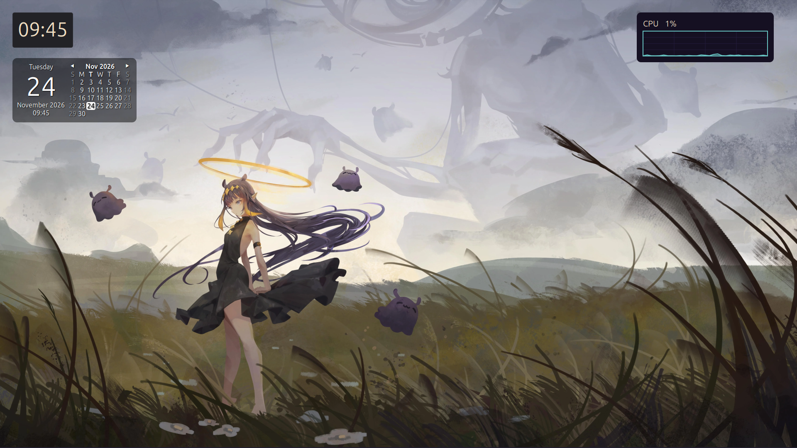
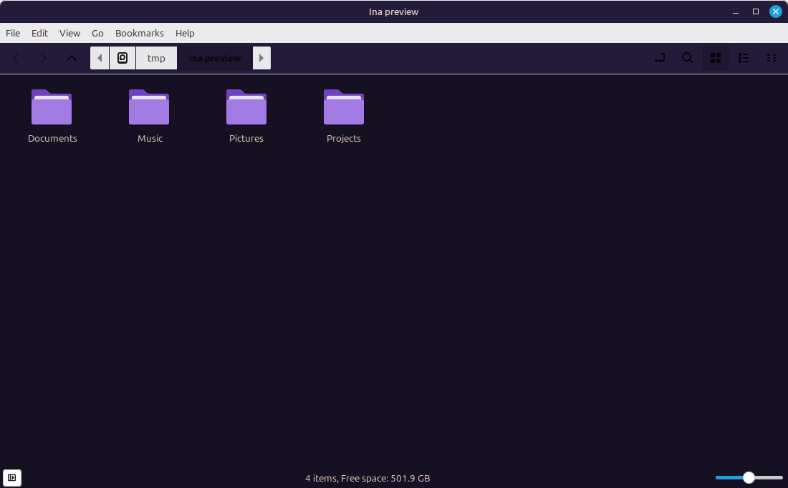
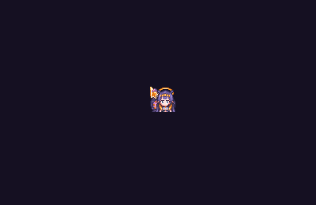
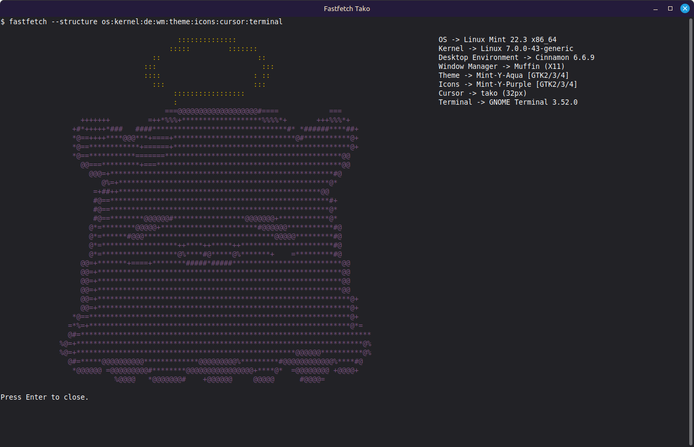
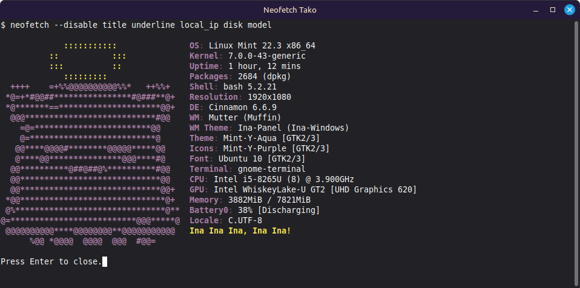
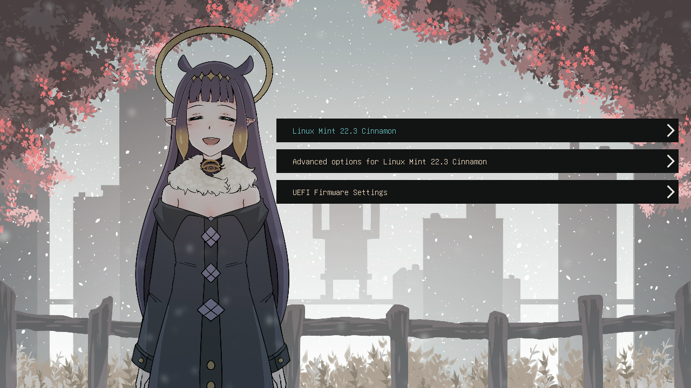
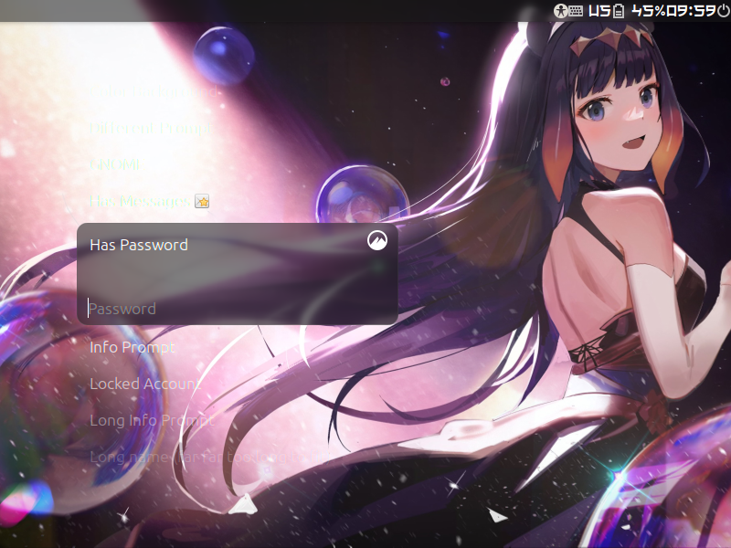
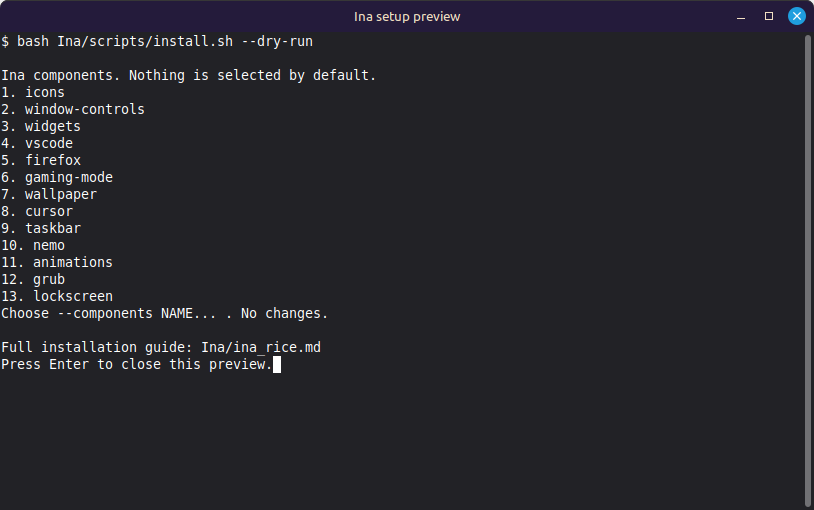

# Ina configuration

Ina configures a purple and parchment Cinnamon desktop using the palette in [colors.sh](dotfiles/colors.sh). Run examples from the repository root. The component scripts preview by default; the [combined runner](ina_rice.md) documents `ina.sh`, which applies by default unless `--dry-run` is present.

## Screenshots

See the [installation guide](ina_rice.md) for package setup, image selection, preview, and application. Select any screenshot to open it at full size.

### Desktop and windows

<table>
  <tr>
    <td width="50%" valign="top">
      <a href="screenshots/desktop.png"></a>
      <p>Desktop with the clock, calendar, and CPU graph. The panel is hidden in this capture. Select the wallpaper separately as described in the installation guide.</p>
    </td>
    <td width="50%" valign="top">
      <a href="screenshots/nemo.png"></a>
      <p>Nemo with Ina styling and four temporary sample folders.</p>
    </td>
  </tr>
</table>

### Animated cursors

<table>
  <tr>
    <td width="50%" valign="top">
      <a href="screenshots/cursor.gif"></a>
      <p>Recorded desktop cursor animation from the installed Tako cursor at 32 px.</p>
    </td>
    <td width="50%" valign="top">
      <a href="screenshots/login-cursor.gif"></a>
      <p>Recorded login cursor animation from the installed Tako cursor at 40 px in an isolated preview.</p>
    </td>
  </tr>
</table>

The optional desktop cursor is credited to NOiiRE in [credits](credits.md). The original creator of the separately installed login cursor is [unverified]. The supported cursor component selects DMZ-White.

### Terminal Takos

<table>
  <tr>
    <td width="50%" valign="top">
      <a href="screenshots/fastfetch.png"></a>
      <p>Fastfetch with the installed large Tako artwork and selected system details.</p>
    </td>
    <td width="50%" valign="top">
      <a href="screenshots/neofetch.png"></a>
      <p>Neofetch with the installed compact Tako artwork.</p>
    </td>
  </tr>
</table>

Identifying fields are omitted from both captures. These optional tools have separate configuration scripts and are excluded from the combined installer.

### Boot and login

<table>
  <tr>
    <td width="50%" valign="top">
      <a href="screenshots/grub.png"></a>
      <p>Installed GRUB theme rendered in <code>grub-emu</code> with sample menu entries. See the <a href="#grub-preparation-and-activation">GRUB instructions</a> for preparation and activation.</p>
    </td>
    <td width="50%" valign="top">
      <a href="screenshots/login-screen.png"></a>
      <p>Existing login-screen appearance in Slick Greeter's test mode, with test accounts. This machine has a separately configured login background and theme. The current login-screen script preserves the existing configuration. Some test-account labels have low contrast against this background.</p>
    </td>
  </tr>
</table>

### Setup preview

<p align="center">
  <a href="screenshots/setup.png"></a>
</p>

Selective installer preview using `bash Ina/scripts/install.sh --dry-run`. The menu lists the available components. Follow the [installation guide](ina_rice.md) to choose and apply your setup.

## Environment and dependencies

Live desktop application requires Linux Mint 22.3, Cinnamon 6.6.9, and a Cinnamon X11 session. Components check these values and refuse other environments. Run component scripts as the desktop user. The combined runner can route a sudo invocation back to that user and has a separate privileged GRUB helper. No component installs packages or restarts the desktop or computer. Sources: [Bash helpers](scripts/lib/shell-common.sh), [Python engine](scripts/lib/engine.py), and [runner](ina_rice.sh).

Required tools depend on the selected component:

| Use | Dependencies |
| --- | --- |
| Bash components and restore | Bash, `jq`, GNU coreutils, util-linux `flock`, `awk`, `sed`, `grep`; desktop settings also need `gsettings` and installed Cinnamon schemas. |
| VS Code, Firefox, lockscreen setup, older backup recovery, combined runner selection | Python 3. Settings validation and lock image decoding need `python3-gi`, GLib/GIO, and GdkPixbuf introspection. VS Code and Firefox are configured through their selected user files. |
| Icons, windows, cursor, taskbar | Installed `mint-y-icons`, `mint-themes`, or `dmz-cursor-theme` as appropriate. Theme scripts check their installed files and available license notices. |
| Native builds and live lock setup | `cc` with C11 support and the system linker. Helpers dynamically load runtime libraries, so their build does not require GTK/GIO development headers or `pkg-config`. |
| Image decoding | GdkPixbuf runtime `libgdk_pixbuf-2.0.so.0`; absent a matching installed native image checker, Bash falls back to Python GI decoding. |
| System widget placement | GTK 3 GDK runtime `libgdk-3.so.0` and access to the desktop display. Application builds a temporary helper if a matching installed one is absent. |
| Native lock service | systemd user manager, GLib/GIO `libgio-2.0.so.0`, JSON-GLib `libjson-glib-1.0.so.0`, GdkPixbuf, and the distribution Cinnamon screensaver. GTK animations must be enabled for motion. `gdbus` is needed by `--lock-now`. |
| Image downloads and GRUB preparation | `wget`, `timeout`, `head`, `od`, `df`; GRUB application also needs ImageMagick `convert` to decode and normalize progressive JPEGs into baseline JPEGs. |
| GRUB activation through the runner | `sudo`, `update-grub`, and `grub-script-check`, plus a working `/boot/grub/grub.cfg`. |
| Gaming mode | util-linux `setsid`, `sleep`, `kill`, and the selected game command. Optional power profiles need `powerprofilesctl` and an available selected profile. |
| Updating an already installed vendored widget | `gdbus` for Cinnamon's `ReloadXlet` method when its source or schema changes. |

Sources: [Bash helpers](scripts/lib/shell-common.sh), [native build script](scripts/build-native.sh), [image helper](scripts/lib/images.sh), [position helper](scripts/lib/widget-position.sh), [lock setup](scripts/lib/components/lockscreen.py), and [native sources](src).

Bash component path arguments must be absolute, single-line paths. Configuration, data, and state destinations must be beneath the user's home directory. Symbolic links and ambiguous array escaping are refused. The combined runner resolves relative input paths from the `Ina` directory, independently of the current working directory. No fonts, browser extensions, editor extensions, or cursor generators are installed.

## Palette

| Name | Value |
| --- | --- |
| Abyss | `#151022` |
| Deep violet | `#241B3B` |
| Tentacle purple | `#7759A6` |
| Lavender | `#B9A1D4` |
| Ancient parchment | `#F1DFC2` |
| Soft peach | `#E7B3A8` |
| Eldritch teal | `#67C4C2` |
| Ink | `#0B0912` |
| Muted text | `#CFC4D9` |
| Warning accent | `#D98C9D` |

## Component commands

Omitting `--apply` previews a component. An explicit `--dry-run` takes precedence over `--apply`. Desktop application also requires `--apply-desktop`; Firefox and VS Code file edits do not require it. A preview can read settings, inspect files, and decode selected images, but does not download images, compile helpers, create backups, enable services, launch a game, or write configuration. Source: [argument handling](scripts/lib/shell-common.sh) and [Python engine](scripts/lib/engine.py).

| Component | Preview | Application and behavior |
| --- | --- | --- |
| [Icons](scripts/icons.sh) | `bash Ina/scripts/icons.sh --dry-run` | Add `--apply --apply-desktop`. Select installed Mint-Y-Purple after checking its installed license and source notice. |
| [Window controls](scripts/window-controls.sh) | `bash Ina/scripts/window-controls.sh --dry-run` | Add `--apply --apply-desktop`. Recolour installed Mint-Y constants, copy the necessary SVGs and copyright notice into `Ina-Windows`, and put minimize, maximize, close on the right. Use Ina parchment for minimize, maximize, and restore on dark GTK 3 header bars. Applying this component also refreshes Cinnamon's window frames. The live refresh uses `busctl`. If Cinnamon cannot refresh its frames, log out and back in. Reopen applications that draw their own GTK header bars to load the updated style. |
| [Widgets](scripts/widgets.sh) | `bash Ina/scripts/widgets.sh --dry-run --widgets clock calendar system` | Add `--apply --apply-desktop`. Select the stock clock and vendored Calendar/System Monitor Graph. Preserve unrelated desklets and existing IDs. Retire this project's old music desklet. See details below. |
| [VS Code](scripts/lib/components/vscode.py) | `bash Ina/scripts/vscode.sh --dry-run --settings "$HOME/.config/Code/User/settings.json"` | Add `--apply`. Merge palette and terminal colours, solid cursor, smooth scrolling, reduced workbench motion, and minimum terminal contrast 4.5. Retain comments, unrelated keys, font size, icon theme, and extensions. Malformed JSONC and duplicate keys are refused. |
| [Firefox](scripts/lib/components/firefox.py) | `bash Ina/scripts/firefox.sh --dry-run` | List detected profiles. Select `--profile PATH`, optionally add `--user-chrome`, then add `--apply`. Close Firefox first. Write owned `user.js` preferences and optional toolbar CSS. Restart manually to load them. |
| [Gaming mode](scripts/gaming-mode.sh) | `bash Ina/scripts/gaming-mode.sh --dry-run -- your-game` | Add `--apply --apply-desktop`. Suppress notifications and desktop/workspace effects during the supplied command. Restore on exit. Optional `--power-profile balanced` selects an available profile. |
| [Lockscreen images](scripts/lockscreen.sh) | `bash Ina/scripts/lockscreen.sh --download-images --dry-run` | Add `--apply --approved`. Download the eight selected JPEGs and write local `assets.json`. This preparation alone does not enable motion. |
| [Live lock motion](scripts/lib/components/lockscreen.py) | `bash Ina/scripts/lockscreen.sh --dry-run --asset-config "$HOME/.local/share/ina/lockscreen/assets.json" --approved --force-lock-on-activation` | Add `--apply --apply-desktop`. Compile and install a managed C worker/helper and user service. Explicitly lock a supervised active screensaver, pan/zoom the wallpaper, cycle the configured images, and restore the independent desktop image on unlock. See limits below. |
| [Desktop wallpaper](scripts/wallpaper.sh) | `bash Ina/scripts/wallpaper.sh --dry-run --image /absolute/image.png --approved` | Add `--apply --apply-desktop`. Decode an approved static image, disable slideshow, select it with zoom. No download. |
| [Cursor](scripts/cursor.sh) | `bash Ina/scripts/cursor.sh --dry-run` | Add `--apply --apply-desktop`. Select DMZ-White size 32 through Cinnamon settings and user GTK 3 `settings.ini`. Preserve unrelated GTK settings; reject duplicate cursor keys or Settings sections. Reopen applications if needed. |
| [Taskbar](scripts/taskbar.sh) | `bash Ina/scripts/taskbar.sh --dry-run` | Add `--apply --apply-desktop`. Move the first panel on monitor 0 to the bottom at 40 px. Put menu/window list left, calendar center, and standard status applets right. Preserve custom applets, existing IDs, other panels, and clock formatting. `Ina-Panel` imports the installed Mint-Y-Dark Cinnamon CSS, including base menu styling. |
| [Nemo](scripts/nemo.sh) | `bash Ina/scripts/nemo.sh --dry-run` | Add `--apply --apply-desktop`. Icon view, standard zoom, normal spacing, places sidebar, toolbar, and location bar. Palette CSS includes focused/unfocused selections and excludes Nemo desktop windows. Folder metadata is untouched. |
| [Animations](scripts/animations.sh) | `bash Ina/scripts/animations.sh --dry-run` | Add `--apply --apply-desktop`. Enable built-in window/dialog effects, fade opening/closing, traditional minimize, and default speed. Disable menu, workspace, and resize effects. |
| [GRUB preparation](scripts/grub.sh) | `bash Ina/scripts/grub.sh --dry-run --download-images --approved` | Add `--apply --allow-boot-change`. Prepare user files only, normalize the background to baseline JPEG when necessary, and print manual activation/recovery commands. Use `--image PATH --approved` instead for a local JPEG. |
| [Native helpers](scripts/build-native.sh) | `bash Ina/scripts/build-native.sh --dry-run` | Add `--apply` to build/install four helpers and their source hashes. No desktop opt-in needed. |
| [Selective installer](scripts/install.sh) | `bash Ina/scripts/install.sh --dry-run --components icons taskbar widgets --widgets clock calendar` | Add `--apply --apply-desktop`. Preview every selected component before applying them in order. No default selection. Without names, an interactive terminal offers numbered choices unless explicit dry-run is requested. Each child owns its backup. |
| [Restore](scripts/restore.sh) | `bash Ina/scripts/restore.sh --component taskbar --dry-run` | Add `--apply`. Without `--component`, list backup component names. Restore installer/runner selections individually. |

The Firefox profile and image paths above are placeholders. Select actual existing paths. To select Firefox explicitly:

```bash
bash Ina/scripts/firefox.sh --dry-run --profile "$HOME/.mozilla/firefox/CHOSEN-PROFILE" --user-chrome
bash Ina/scripts/firefox.sh --apply --profile "$HOME/.mozilla/firefox/CHOSEN-PROFILE" --user-chrome
```

Firefox checks legacy lock markers and an advisory lock on `.parentlock`; only a narrowly recognized stale local lock symlink is accepted. Flatpak and other installations require their explicit profile path. Firefox version compatibility remains [unverified].

## Widgets

Clock uses parchment text, size 36, and `%H:%M`; new clock/calendar instances start at `(30,30)` and `(30,140)`. Calendar uses the palette for text, background, Sundays, and Saturdays. System Monitor Graph uses a two-second refresh interval, parchment text, abyss background, deep violet midline, and teal graph lines. Existing non-colour preferences and Cinnamon's schema metadata are retained through value-specific backup records. Source: [widgets](scripts/widgets.sh) and [widget settings helper](scripts/lib/widget-settings.sh).

The system widget is positioned in the primary monitor's upper-right work area with a panel-aware margin. Its `scale-size` and display scale determine the required space; application fails if geometry cannot be read or the widget does not fit. Existing instance IDs are retained and coordinates are updated. An unbuilt preview reports unresolved geometry instead of inventing a position. `build-native.sh --apply` installs the helper needed to resolve placement during subsequent previews. Source: [position helper](scripts/lib/widget-position.sh).

When an existing vendored widget's source or schema changes, the script reloads that desklet after committing its files/settings transaction. A failed reload leaves the journal available and prints retry and recovery commands. The system graph defers its first update until its actor is attached to Cinnamon. Sources: [widgets](scripts/widgets.sh) and [graph source](vendor/desklets/system-monitor-graph@rcassani/desklet.js).

Music is unavailable. Application removes `ina-media@holo-ricing` from enabled desklets and deletes only unchanged files established as project-owned by the widgets journal. Externally changed or untracked files are retained. Other music widgets are preserved. Calendar and System Monitor Graph retain their adjacent [Calendar](vendor/desklets/calendar@deeppradhan/LICENSE) and [graph](vendor/desklets/system-monitor-graph@rcassani/LICENSE) licenses. Source: [retirement helper](scripts/lib/widget-removal.sh).

## Image choices and downloads

[assets.example.json](dotfiles/assets.example.json) contains `desktop_image`, three to eight `lock_images`, optional `grub_image`, reserved `login_image`, and `approved`. Populate it with absolute local paths and pass `--asset-config PATH`. Direct component commands require explicit `--approved`; the JSON field does not grant their approval. The combined runner has separate reuse rules for previously approved selections, described in [its guide](ina_rice.md). `login_image` is unused by these commands. The wallpaper command downloads nothing.

Selected images are fully decoded through GdkPixbuf and must be static. Header checks are also performed for Bash wallpaper/JPEG inputs. These checks do not establish copyright, permissions, safe subject matter, or the absence of flashing content in a source video. Use approved static files. Record original URL, author, license, retrieval date, exact reused paths, and modifications in [credits](credits.md); unresolved permissions remain [unverified].

[image-sources.json](dotfiles/image-sources.json) records nine selected download URLs, metadata, permissions status, and the recorded check date. The GRUB record identifies Alpha Coders wallpaper 1123929 by mistimagi for private personal use. The lock JPEGs download in this order:

1. MoeWalls winter forest thumbnail, `lock-1.jpg`.
2. ArtStation background 4, `lock-2.jpg`.
3. ArtStation background 1, `lock-3.jpg`.
4. Donmai image `f6f3c948`, `lock-4.jpg`.
5. Siliconera Ina avatar, `lock-5.jpg`.
6. Reactor image 8455417, `lock-6.jpg`.
7. Reactor image 8656218, `lock-7.jpg`.
8. JoyReactor image 9192157, `lock-8.jpg`.

The lock image authorship/permissions and exact ArtStation CDN associations retain the [unverified] qualifiers in that record. Download permission flags in configuration are not proof of redistribution rights. Image bytes are stored locally, not in the repository.

Downloads require explicit application and `--download-images --approved`. They use HTTPS, refuse redirects, disable wget user configuration and HSTS cache writes, check at least 128 MiB free on state and destination filesystems, and limit each download pipeline to 180 seconds and 32 MiB. A bounded stream limits temporary output independently of Content-Length. Matching component-owned downloads are reused; conflicting existing files are refused. Validated bytes are journaled before publication and temporary files are removed on catchable interruption. Source: [image helper](scripts/lib/images.sh).

## Lock cycle and native worker

Prepare the selected images while choosing an independent desktop image:

```bash
bash Ina/scripts/lockscreen.sh --download-images --dry-run --image /absolute/desktop.png
bash Ina/scripts/lockscreen.sh --download-images --apply --approved --image /absolute/desktop.png
```

A fresh installation needs all eight image URLs to work. ArtStation returned HTTP 403 during the November 22 download check. If you already have the three original images, pass their configuration with `--asset-config PATH` during preparation. The downloader keeps those paths and fetches the five additions. See the [download script](scripts/lockscreen.sh).

Preparation writes `$XDG_DATA_HOME/ina/lockscreen/lock-1.jpg` through `lock-8.jpg`, and `assets.json`, defaulting to `~/.local/share/ina/lockscreen`. Repeated preparation retains the existing desktop selection when `--image` is omitted. Without a selection, `desktop_image` is empty and live setup will refuse it. Preparation changes no service, login, wallpaper, or boot setting. Source: [shell preparation](scripts/lockscreen.sh).

Preview and enable motion separately:

```bash
bash Ina/scripts/lockscreen.sh --dry-run --asset-config "$HOME/.local/share/ina/lockscreen/assets.json" --approved --force-lock-on-activation
bash Ina/scripts/lockscreen.sh --apply --apply-desktop --asset-config "$HOME/.local/share/ina/lockscreen/assets.json" --approved --force-lock-on-activation
```

For custom paths, `--image DESKTOP --images LOCK1 LOCK2 LOCK3 --approved` can replace `--asset-config`. Supply three to eight lock paths. All files, including the separate desktop image, must decode as static images and represent distinct files, including no hard-link duplicates. Live installation requires `--force-lock-on-activation`, which authorizes immediate locking of an active screensaver that this worker supervises. The selective installer supports this flag with `--asset-config PATH --approved` and without `--download-images`; the combined runner uses `--enable-lock-rotation`.

Python handles setup and restoration. Setup compiles [lockscreen-worker.c](src/lockscreen-worker.c) and [lockscreen-native.c](src/lockscreen-native.c) before stopping an existing managed service, installs the executables under `$XDG_DATA_HOME/ina/lockscreen`, writes `$XDG_CONFIG_HOME/ina/lockscreen-service.json`, and enables/starts `$XDG_CONFIG_HOME/systemd/user/ina-lockscreen.service`. It refuses unowned active/enabled services or units and externally changed owned files. Reapplication retains the original backups and validated cycle position, retires an older owned Python worker, and updates the service. Source: [setup](scripts/lib/components/lockscreen.py).

The C worker monitors Cinnamon's session-bus screensaver state. If no screensaver owns the bus name, it starts the distribution screensaver and supervises that child. Rotation is permitted only when the bus owner PID is that live child, locking is enabled, lockdown permits locking, and the session passes its live/guest/passwordless-login checks. It deliberately calls `Lock`, verifies the owner and active state, then selects the next image. It never takes over, terminates, or restarts an already running screensaver. Consequently an existing unrelated screensaver can leave the service running without rotation until that screensaver exits naturally. Source: [worker](src/lockscreen-worker.c).

The worker visits each configured image in order, then returns to the first. Existing three-image configurations continue to work. To expand a managed installation, repeat image preparation and reapply live setup with the updated `assets.json`. Include your existing `--lock-image-seconds` value when reapplying. Default dwell is 300 seconds while locked; `--lock-image-seconds 10..3600` changes it on the direct lockscreen command. `$XDG_STATE_HOME/ina/lock-rotation-live.json` stores a private ownership token and the next zero-based index. The next lock continues from that saved position. Invalid or externally changed state is refused. An exclusive private lock file prevents competing workers. Source: [worker](src/lockscreen-worker.c).

GTK animates Cinnamon's existing wallpaper image using [lockscreen-motion.css](dotfiles/lockscreen-motion.css): a 24-second alternating pan/zoom with 360 transform steps per leg, at most 15 new transform values per second. This does not change GTK's global frame clock. Cinnamon supplies crossfades between still images. No video decoder, replacement lock window, authentication, or input handling is added. GTK animations must be enabled. An already running locker loads the CSS on its next natural process start; setup never restarts it.

The native helper changes Cinnamon's shared background URI while locked. The configured desktop image is restored on unlock, screensaver owner loss, service stop, and normal worker exit. Pipe closure lets the separate helper attempt restoration after a worker crash; `ExecStopPost` also invokes restoration, and the service restarts after failure. Recovery is conditional on the wallpaper still matching an owned value; external wallpaper edits are preserved and reported. This is a recovery design, not a guarantee after power loss or simultaneous process termination. A recorded Mint X11 check observed ordered image changes, pan motion, normal password unlock, and restoration; the recovery paths still have the limits described below. Sources: [worker](src/lockscreen-worker.c) and [helper](src/lockscreen-native.c).

Inspect service status and cycle position without triggering a lock:

```bash
systemctl --user status ina-lockscreen.service
journalctl --user -u ina-lockscreen.service
"${XDG_DATA_HOME:-$HOME/.local/share}/ina/lockscreen/lockscreen-worker" "${XDG_CONFIG_HOME:-$HOME/.config}/ina/lockscreen-service.json" --status
```

`--status` reports `next_index`. To request a lock explicitly, run `bash Ina/scripts/lockscreen.sh --lock-now` as the X11 desktop user, or add `--dry-run` to preview. This checks standard Cinnamon locking settings, allows 60 seconds for the lock reply, and checks `GetActive`. Acknowledgement and active state do not independently verify the authentication UI. Unlock normally.

Restore live setup before removing its images:

```bash
bash Ina/scripts/restore.sh --component lockscreen --dry-run
bash Ina/scripts/restore.sh --component lockscreen --apply
bash Ina/scripts/restore.sh --component lockscreen-images --apply
```

Live restore first validates owned executable/unit files, disables and stops the managed service, acquires its live lock, then restores backed-up settings, CSS, files, and token-owned cycle state, and reloads the user manager. Restore refuses conflicting external edits. `lockscreen-images` owns only the separately prepared images/configuration. The Python `--test-root` simulation is isolated and does not install a live service or prove real lock behavior. Sources: [restore routing](scripts/restore.sh), [Python restore](scripts/lib/engine.py), and [lock model](scripts/lib/components/lockscreen.py).

## Native helpers

```bash
bash Ina/scripts/build-native.sh --dry-run
bash Ina/scripts/build-native.sh --apply
```

This builds `image-check`, `lockscreen-native`, `lockscreen-worker`, and `widget-position` into `$XDG_DATA_HOME/ina/bin`, records each C source hash beside it, and uses a `native` backup journal. Compilation uses C11, optimization, warnings as errors, and linker RELRO/NOW. Each result receives a small check before installation. Matching source hashes allow image validation and monitor geometry queries to reuse installed helpers. Lock service setup separately builds its managed copies. Restore these shared helpers with `bash Ina/scripts/restore.sh --component native --apply`. Source: [build script](scripts/build-native.sh).

## GRUB preparation and activation

```bash
bash Ina/scripts/grub.sh --dry-run --download-images --approved
bash Ina/scripts/grub.sh --apply --allow-boot-change --download-images --approved
```

A fresh installation needs all eight image URLs to work. ArtStation returned HTTP 403 during the November 22 download check. If you already have the three original images, pass their configuration with `--asset-config PATH` during preparation. The downloader keeps those paths and fetches the five additions. See the [download script](scripts/lockscreen.sh).

Preparation writes `$XDG_DATA_HOME/ina/grub`, defaulting to `~/.local/share/ina/grub`. It does not run sudo or alter boot files. Use `--image /absolute/background.jpg --approved` for a local JPEG, or `--asset-config PATH` with a separate `grub_image`; the desktop field is not a fallback. The prepared baseline JPEG is normalized locally when necessary, without changing the original input. Source: [GRUB component](scripts/grub.sh).

The right-side menu adapts Aleph1-9012's Evangelion theme layout, retains three unchanged dark selector pieces, and uses parchment entries, teal selection text, the selected background, and GRUB's default font. No character artwork, custom font, installer, or GRUB module is copied from that project. Its [Apache 2.0 license](vendor/grub-evangelion/LICENSE) and exact reused paths/revision are retained in [NOTICE](vendor/grub-evangelion/NOTICE).

Preview with `grub-emu` or a disposable VM at the intended resolution before activation. Long labels, contrast, selection, clipping, JPEG compatibility, and real boot recovery remain [unverified]. The component prints a manual recipe requiring unused Ina destinations. The [combined runner](ina_rice.md) can activate with `--install-grub`, keeps a root-owned journal under `/var/lib/ina-rice-grub`, and validates the generated menu. Its restore command is:

```bash
sudo bash Ina/ina_rice.sh --restore-grub --apply
```

Only use this for runner-managed boot files. Existing known Ina installations require its explicit `--adopt-existing-grub` flow; unknown or externally changed files are refused. Successful runner restore archives the boot journal and prints the generated-menu fallback location. User preparation is restored separately with `bash Ina/scripts/restore.sh --component grub --apply`.

For files installed using the component's current manual recipe, remove only those exact destinations and regenerate the menu:

```bash
sudo rm -- /etc/default/grub.d/90-ina.cfg /boot/grub/themes/ina/theme.txt /boot/grub/themes/ina/background.jpg /boot/grub/themes/ina/LICENSE /boot/grub/themes/ina/NOTICE
sudo rm -- /boot/grub/themes/ina/selected_c.png /boot/grub/themes/ina/selected_e.png /boot/grub/themes/ina/selected_w.png
sudo rmdir -- /boot/grub/themes/ina
sudo update-grub
```

Older installations may have selector files under `selectors/`; use the recipe/journal corresponding to that installation. At GRUB's prompt, `set theme=` then Esc is the documented rendering fallback, still [unverified]. No command automatically reboots.

## Backups and restoration

Restoring window controls removes the temporary Cinnamon style provider. If Cinnamon started with Ina already applied, log out and back in to clear its startup copy of the GTK styles.

Backups are stored at `$XDG_STATE_HOME/ina/backups/COMPONENT/manifest.json`, defaulting to `~/.local/state/ina/backups/COMPONENT/manifest.json`. State mode is 700 and manifest mode is 600. Bash journals use `ina-bash-1`; retained Python components use their earlier format. Originals include file existence, contents, modes, and setting values. First-application originals are retained across repeated applications, while interrupted runs attempt to roll back only their own changes. Operations share a transaction lock and use atomic file replacement. Sources: [Bash helpers](scripts/lib/shell-common.sh) and [Python engine](scripts/lib/engine.py).

```bash
bash Ina/scripts/restore.sh
bash Ina/scripts/restore.sh --component window-controls --dry-run
bash Ina/scripts/restore.sh --component window-controls --apply
```

Restoration requires `--apply` but no desktop opt-in. It checks owned values and files for conflicts before restoring their originals, removing component-created files, and removing only tracked empty directories. Conflicting owned edits stop restoration; preserve them manually before retrying. Marked GTK CSS blocks restore independently so surrounding user CSS survives. Widget journals restore owned `.value` fields while retaining unrelated widget values and schema metadata. Source: [restore helpers](scripts/lib/shell-common.sh) and [widget settings](scripts/lib/widget-settings.sh).

Restore an older Python journal before applying its Bash replacement. `restore.sh` routes such journals through Python and archives migrated components as `manifest.python-restored.json`. Firefox, VS Code, and lockscreen retain their Python journals. Close Firefox before restoring; restore adjusts only owned `prefs.js` values and restores its backed-up user files, preserving unrelated preferences. Restart Firefox manually afterward.

Gaming mode snapshots each run and retains previous run journals. It launches the command in a new session, returns its exit status, and attempts to terminate its process group and restore settings on exit, launch failure, or catchable interruption. An active interrupted journal blocks a new gaming run. After SIGKILL or another uncatchable termination:

```bash
bash Ina/scripts/restore.sh --component gaming-mode --apply
```

Game signal handling and restoration on the real desktop remain [unverified]. Source: [gaming mode](scripts/gaming-mode.sh).

For text-console recovery, run as the affected desktop user from the repository:

```bash
dbus-run-session -- bash Ina/scripts/restore.sh --component taskbar --apply
dbus-run-session -- bash Ina/scripts/restore.sh --component window-controls --apply
dbus-run-session -- bash Ina/scripts/restore.sh --component widgets --apply
dbus-run-session -- bash Ina/scripts/restore.sh --component cursor --apply
dbus-run-session -- bash Ina/scripts/restore.sh --component animations --apply
```

Scripts print recovery commands with the absolute repository path. A separate bus does not establish a running user service manager; live lock restore must also reach the desktop user's systemd manager. Actual recovery from an unusable desktop remains [unverified].

## Verification and scope

This guide describes source behavior and the recorded check below. Broad application, repeat runs, failure recovery, downloaded content, and boot recovery are not certified. Local test harnesses may be present under the ignored `Ina/tests` directory, covering isolated settings/files, transactions, native helper behavior, and regression cases. They are not tracked in this checkout and are unavailable in a clean clone. Their presence does not imply every test passes; older component harnesses include historical assumptions, so inspect their fixtures before use. The earlier tracked tests remain in [commit 303e5d7](https://github.com/Roonil03/Holo-Ricing/tree/303e5d78dc515395c264af554a7f1fd955e11da7/Ina/tests). Static parsing and whitespace checks do not establish runtime correctness.

The recorded live lock check on Mint X11 used a ten-second interval and observed `lock-1`, `lock-2`, `lock-3`, then `lock-1`. The user confirmed pan motion and normal password unlock. The static desktop image returned, `GetActive` was false after unlock, and the service recorded zero restarts. This checks the ordinary cycle/unlock path only. Crash recovery, session loss, unrelated screensaver ownership, and power-loss recovery remain [unverified]. Ten seconds can be selected only through the direct `lockscreen.sh --lock-image-seconds 10` setup command; the installer and combined runner do not expose that option.

`--test-root PATH` redirects component state/files into an existing real directory beneath `/tmp`. It is for isolated simulation; it does not validate a real Cinnamon session. The [historical nested Cinnamon check](https://github.com/Roonil03/Holo-Ricing/blob/303e5d78dc515395c264af554a7f1fd955e11da7/Ina/tests/check_cinnamon.py) additionally needs Xephyr, `dbus-run-session`, Cinnamon, `timeout`, GTK 3, and an active X11 display.

Older `bootlogo.sh`, `cursor-toggle.sh`, `desktop-bg.sh`, `fastfetch.sh`, `login_screen.sh`, `neofetch.sh`, and `tiling-window.sh` remain excluded from the supported component installer/runner. They do not share its complete preview and backup behavior. The recorded `gTile@shuairan` extension is not changed by these components. Run `bash Ina/scripts/login_screen.sh --dry-run` to report the configured LightDM background. This script reads the greeter configuration and preserves the login image. Older artwork permissions remain [unverified]; see [credits](credits.md).

## License and rights holders

The repository's [MIT license](../LICENSE) covers original project code unless a file says otherwise. External themes, code, icons, cursors, and artwork retain their own licenses. See [credits](credits.md) and the license files beside vendored components.

Ninomae Ina'nis, hololive, and related marks belong to their respective rights holders, including Cover Corp. This is an unofficial fan configuration with no claimed affiliation or endorsement.
